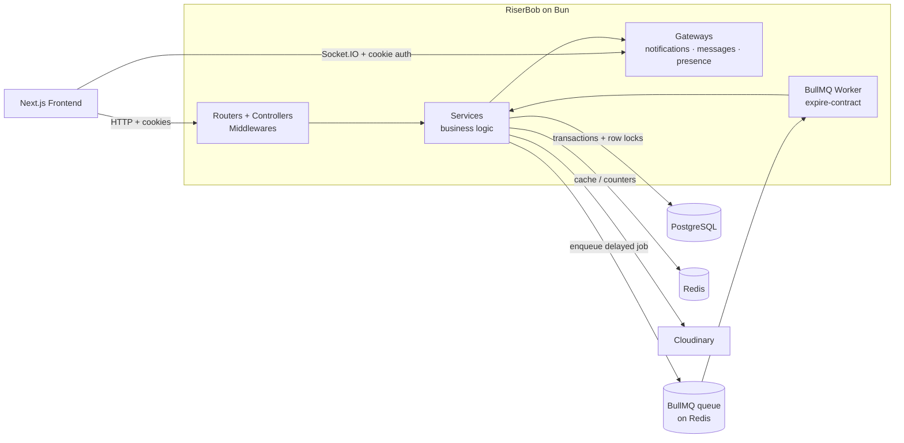
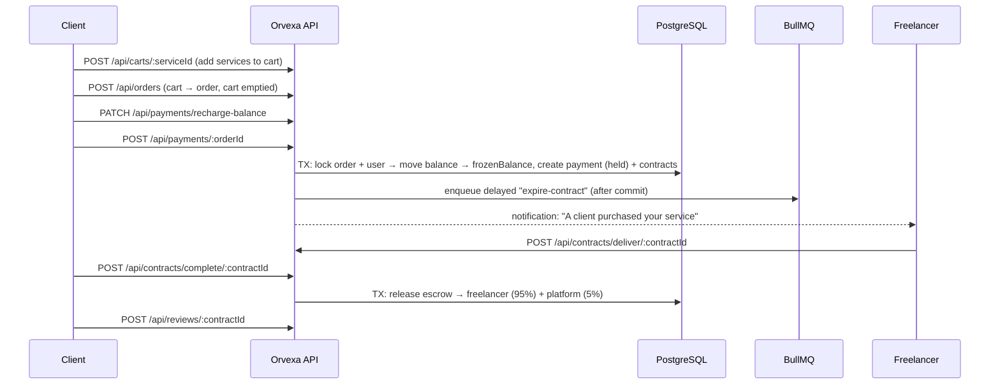
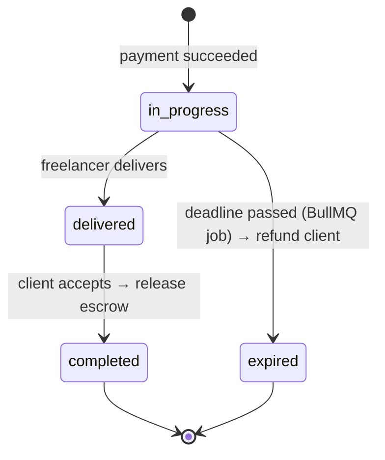

# Orvexa Backend — Orvexa Digital Services Marketplace API

REST + WebSocket API for **Orvexa**, a freelance services marketplace where clients buy services from freelancers, pay through an **escrow-style balance system**, and work together inside a **contract** until the delivery is accepted.

Built with **RiserBob** (on **Bun** + TypeScript), **PostgreSQL (Sequelize)**, **Redis**, **BullMQ** and **Socket.IO**.

> The interesting part of this project is not the CRUD — it is how money and contract state are kept **consistent under concurrency and failure**. See [Engineering Challenges & Solutions](#engineering-challenges--solutions).

---

## Table of Contents

- [Tech Stack](#tech-stack)
- [About RiserBob](#about-riserbob)
- [Architecture Overview](#architecture-overview)
- [Project Structure](#project-structure)
- [Domain Model](#domain-model)
- [Business Flow](#business-flow)
- [Contract Lifecycle](#contract-lifecycle)
- [Engineering Challenges & Solutions](#engineering-challenges--solutions)
  - [1. Race condition in payment](#1-race-condition-in-payment)
  - [2. Automatic contract expiration with BullMQ](#2-automatic-contract-expiration-with-bullmq)
  - [3. Safe contract completion & commission split](#3-safe-contract-completion--commission-split)
  - [4. Side effects only after commit](#4-side-effects-only-after-commit)
  - [5. Price & delivery-time snapshots](#5-price--delivery-time-snapshots)
  - [6. Login hardening & user-enumeration resistance](#6-login-hardening--user-enumeration-resistance)
  - [7. Redis caching](#7-redis-caching)
  - [8. Real-time layer](#8-real-time-layer)
- [Authentication & Authorization](#authentication--authorization)
- [API Reference](#api-reference)
- [Getting Started](#getting-started)
- [Environment Variables](#environment-variables)
- [Database Seeding](#database-seeding)
- [Testing](#testing)
- [Known Limitations & Roadmap](#known-limitations--roadmap)

---

## Tech Stack

| Layer            | Technology                                                                                          |
| ---------------- | --------------------------------------------------------------------------------------------------- |
| Runtime          | Bun (scripts, dev server, bundler and test runner)                                                  |
| Framework        | **RiserBob** (`riser-bob`) + `@riser-bob/cookie` (TypeScript, ESM)                                  |
| Database         | PostgreSQL via Sequelize 6 (`sequelize`, `pg`, `pg-hstore`)                                         |
| Cache / counters | Redis (`ioredis`)                                                                                   |
| Background jobs  | BullMQ (`bullmq`)                                                                                   |
| Real-time        | Socket.IO (`socket.io`, attached with `bob.spongSocketIO`, custom cookie-auth adapter)              |
| Auth             | JWT (access + refresh) via `jsonwebtoken` in HTTP-only cookies, `bcryptjs`                          |
| File storage     | Cloudinary (`cloudinary`, uploads read from native `multipart/form-data` via `spongReq.formData()`) |
| Validation       | RiserBob `Validator` + per-module rule schemas (`rules/*.ts`)                                       |
| API docs         | Route tables in this README (see [API Reference](#api-reference))                                   |
| Testing          | `bun:test` (Bun's built-in test runner)                                                             |
| Tooling          | TypeScript (`tsc --noEmit`), `bun build`, Prettier config (`.prettierrc`)                           |

---

## About RiserBob

RiserBob is a TypeScript HTTP framework powered by Bun. It is **not** Express or NestJS: there are no decorators and no DI container. Everything in this project uses the APIs RiserBob actually exposes:

| RiserBob API                                                                      | Used for                                                                             |
| --------------------------------------------------------------------------------- | ------------------------------------------------------------------------------------ |
| `new RiserBob({ funnyMode: false })`                                              | Creates the application (`bob`).                                                     |
| `bob.spongUse(middleware)`                                                        | Global middleware (`corsMiddleware`, `loggerMiddleware`).                            |
| `bob.spongGet / spongPost / spongPut / spongPatch / spongDelete(path, handler, …)` | Route registration. Extra arguments after the handler are route-level middlewares.   |
| `SpongHandler` — `(spongReq, spongRes) => Response`                               | Controller methods. `spongReq.json()`, `.formData()`, `.params`, `.query`, `.user`.  |
| `spongRes.SpongOK / SpongBadRequest / SpongNotFound / SpongUnauthorized / …`      | Typed JSON responses (also `SpongForbidden`, `SpongUnprocessableContent`).           |
| `AuthMiddleware(verifyUser, { mode: 'cookie', cookieName: 'token' })`             | Cookie-based authentication; sets `spongReq.user`.                                   |
| `MiddlewarePipeline`                                                              | Composes several middlewares into one (used by `ProtectedMiddleware`).               |
| `Validator.validate(body, Rule)` + `ValidationSchema`                             | Input validation with declarative rules such as `['required', 'string', 'minLength:8']`. |
| `HttpError`                                                                       | Errors with an HTTP status (used by the token layer).                                |
| `bob.spongSocketIO(options)`                                                      | Creates the Socket.IO server bound to the same HTTP server.                          |
| `bob.spongListen(port, callback)`                                                 | Starts the server (port **4000**).                                                   |

**Startup sequence** (`src/index.ts`):

1. Create the `RiserBob` app.
2. `connectDB()` — authenticate with PostgreSQL, set up associations, `sequelize.sync()`.
3. Connect Redis (`RedisConfig.connect()`, shared through the exported `redisConfig`).
4. Register global CORS (origin from `src/url.ts`, `credentials: true`) and logger middlewares, plus `GET /` health/welcome route.
5. Create the Socket.IO server, install `AuthSocketAdapter` (cookie JWT auth) and the `PresenceGateway`.
6. `Modules(bob, io)` — registers all 16 feature modules.
7. Listen on port `4000`.

---

## Architecture Overview



The codebase is organized as **feature modules** (`*.module.ts` wiring → `*.route.ts` router → `*.controller.ts` handlers → `*.service.ts` business logic → Sequelize schema) plus a shared `config` layer (database, Redis, Cloudinary, token manager, middlewares, gateways, socket adapter) and a `utilities` layer (pagination, `sanitizeUser`).

Dependencies are wired **manually by constructor injection**: each module's `register(bob, io?)` method builds its services, controller, middlewares and router, then calls `router.register()`. A service is introduced only where the logic justifies it — some small modules (carts, freelancers, user-profiles, platform-wallets) keep their logic in the controller.

Responses are produced by the controllers through RiserBob's `spongRes` helpers and share the same envelope:

```json
{ "success": true, "message": "…", "data": {} }
```

Errors use the same shape with `"success": false`; validation failures return HTTP `422` with an `errors` object. Paginated lists return `data: { <items>, pagination }` (`page`, `limit` ≤ 100, `total`, `totalPages`, `hasNextPage`, `hasPreviousPage`).

---

## Project Structure

```
backend/
├── src/
│   ├── index.ts                     # bootstrap: DB, Redis, CORS, logger, Socket.IO, modules, listen(4000)
│   ├── modules.ts                   # registers every feature module (bob, io)
│   ├── url.ts                       # FRONTEND_URL used for CORS (HTTP + Socket.IO)
│   ├── REQUIREMENTS.md              # framework notes
│   ├── utilities/                   # pagination helpers, sanitizeUser
│   ├── config/
│   │   ├── adapters/                # AuthSocketAdapter (cookie JWT auth for Socket.IO)
│   │   ├── cloudinary/              # CloudinaryConfig + CloudinaryManager (upload / destroy)
│   │   ├── db/
│   │   │   ├── connect-db.ts        # authenticate + associations + sequelize.sync()
│   │   │   ├── sequelize.ts         # Sequelize instance (PostgreSQL, SSL)
│   │   │   ├── associations.ts
│   │   │   └── redis/               # RedisConfig (connection) + RedisManager (helpers)
│   │   ├── gateways/                # notification, notification-socket, message, presence
│   │   ├── middlewares/             # protected, user-active, roles, user-verification
│   │   └── token/                   # TokenManager (JWT sign / verify) + verifyUser
│   └── modules/
│       ├── auth/
│       ├── users/
│       ├── user-profiles/
│       ├── freelancers/
│       ├── user-verifications/
│       ├── services/
│       ├── carts/                   # cart + cart items
│       ├── orders/
│       ├── payments/
│       ├── contracts/               # service + queues/contracts.queue.ts (BullMQ queue + worker)
│       ├── messages/                # contract chat
│       ├── reviews/
│       ├── notifications/
│       ├── platform-wallets/
│       ├── support-conversations/
│       └── support-messages/
├── dist/                            # `bun run build` output
├── package.json · tsconfig.json · tsconfig.build.json · .prettierrc
└── AGENTS.md · CLAUDE.md            # conventions for AI coding agents
```

Each module follows the same layout:

```
modules/contracts/
├── contracts.module.ts      # wiring (constructor injection) + register(bob, io)
├── contracts.route.ts       # route definitions + middlewares
├── contracts.controller.ts  # SpongHandlers
├── contracts.service.ts     # business logic
├── queues/                  # (contracts only) BullMQ queue + worker
├── schemas/                 # Sequelize models (+ enums/)
├── rules/                   # validation rules (where the module accepts input)
└── tests/                   # bun:test unit tests
```

---

## Domain Model

| Entity                                   | Purpose                                                                                                                                                                                                   |
| ---------------------------------------- | --------------------------------------------------------------------------------------------------------------------------------------------------------------------------------------------------------- |
| **User**                                 | Account with `role` (`admin`, `support`, `freelancer`, `client`), `balance`, `frozenBalance`, `isActive`, hashed `refreshToken`, `lastLoginAt`.                                                           |
| **UserProfile**                          | Avatar, cover, bio (Cloudinary images).                                                                                                                                                                   |
| **Freelancer**                           | Freelancer profile: job title, about, skills, website, `completedOrders`, `ratingAverage`, `ratingCount`.                                                                                                 |
| **UserVerification**                     | Identity verification request (profile image + ID document) with `pending / approved / rejected` and a rejection reason.                                                                                  |
| **Service**                              | A gig: category, title, description, features, keywords, images, `price`, `deliveryDays`, `ordersCount`, status `pending / published / rejected`.                                                        |
| **Cart / CartItem**                      | Client's shopping cart.                                                                                                                                                                                   |
| **Order**                                | Snapshot of the purchased services (JSONB) + `totalAmount` + status (`pending_payment`, `in_progress`, `completed`, `cancelled`, `refunded`, `disputed`).                                                  |
| **Payment**                              | Record of the payment for an order: `held` (escrow) → `completed` (released) or `refunded`. The enum also declares `pending` and `failed`.                                                                |
| **Contract**                             | One contract **per service** inside an order: amount, `deadline`, status, delivery/completion/cancellation timestamps.                                                                                    |
| **Message**                              | Chat message (text + up to 5 images) inside a contract.                                                                                                                                                   |
| **Review**                               | Rating (1–5) + comment, one per completed contract.                                                                                                                                                       |
| **Notification**                         | In-app notification, delivered live over WebSocket. Types: block user, user verification (+ approved / rejected), service review / approved / rejected, contract (+ message / delivered / completed / expired), review created, payment. |
| **PlatformWallet**                       | Accumulates the platform's commission (single row, `key = 'platform'`).                                                                                                                                   |
| **SupportConversation / SupportMessage** | Support tickets (`open` / `closed`) between users and support/admin staff, with up to 5 attachments per message.                                                                                          |

Service categories: `programming`, `design`, `digital_marketing`, `writing_translation`, `video_audio`, `business`, `data_analysis`, `ai`, `engineering`, `lifestyle`.

Monetary values use `DECIMAL(12, 2)`.

---

## Business Flow



1. **Cart → Order** — the cart is turned into an order with a snapshot of each service (title, price, delivery days, freelancer info) and the cart is emptied, all in one transaction.
2. **Payment (escrow)** — the order total moves from the client's `balance` to `frozenBalance`. The money is _held_, not yet paid to the freelancer (the payment is recorded as `held`).
3. **Contracts** — one contract per purchased service is created with a deadline = `now + deliveryDays`.
4. **Work & chat** — client and freelancer chat in real time inside the contract while it is `in_progress`.
5. **Delivery** — the freelancer marks the contract as delivered.
6. **Completion** — the client accepts; the frozen amount is released: **95% to the freelancer, 5% platform commission**.
7. **Review** — the client can rate the service once the contract is completed.
8. **If the freelancer misses the deadline** — a BullMQ job automatically **expires the contract and refunds the client**.

Paying, delivering and completing require an **approved identity verification** (see [Authentication & Authorization](#authentication--authorization)).

---

## Contract Lifecycle



| Status        | Meaning                                          | Who/what moves it here                              | Money effect                                                                                     |
| ------------- | ------------------------------------------------ | --------------------------------------------------- | ------------------------------------------------------------------------------------------------ |
| `in_progress` | Work started, chat enabled, expiry job scheduled | Successful payment                                  | `balance → frozenBalance`                                                                        |
| `delivered`   | Freelancer says the work is ready                | Freelancer (`POST /api/contracts/deliver/:id`)      | none                                                                                             |
| `completed`   | Client accepted the delivery                     | Client (`POST /api/contracts/complete/:id`)         | frozen amount → freelancer (95%) + platform wallet (5%); payment → `completed`, order → `completed` |
| `expired`     | Deadline passed without delivery                 | BullMQ worker                                       | `frozenBalance → balance` (full refund); payment → `refunded`, order → `refunded`                |

The enum also declares `cancelled`, `disputed` and `refunded` (and the schema has `cancelledAt` / `cancellationReason`) as groundwork for a future dispute/cancellation flow — see [Roadmap](#known-limitations--roadmap).

**Rules enforced by the code**

- Only the **contract's freelancer** can deliver; only the **contract's client** can complete.
- A contract can be delivered **only from `in_progress`** (and **not after its deadline**), and completed **only from `delivered`**.
- Chat messages can be sent by participants **only while the contract is `in_progress`**; deleting a message is also limited to `in_progress` contracts (admins can still moderate).
- A review is allowed **only for `completed` contracts**, **once per contract**, and only if a completed payment exists for the order.

---

## Engineering Challenges & Solutions

### 1. Race condition in payment

**The problem.** Payment touches several shared rows (order, user balance, payments, contracts). Without protection, concurrent requests can corrupt money state:

| Scenario                                                                         | What would go wrong                                                                                               |
| -------------------------------------------------------------------------------- | ----------------------------------------------------------------------------------------------------------------- |
| Client double-clicks **Pay** (two identical requests)                            | Both pass the "order is pending" check → the client is charged **twice** and **duplicate contracts** are created. |
| Client pays **two different orders at once** with a balance that only covers one | Both read the same balance → balance goes **negative** / money is spent that does not exist.                      |
| Request crashes halfway                                                          | Balance deducted but no contract created (or the reverse).                                                        |

**The solution** (`PaymentsService.pay`). Everything runs in **one database transaction** that takes **pessimistic row locks** (`SELECT … FOR UPDATE`) in a fixed order:

```ts
const transaction = await this.sequelize.transaction();

// 1. Lock the order (only the owner can pay it)
const order = await this.orderSchema.findOne({
  where: { id: orderId, clientId: userId },
  transaction,
  lock: transaction.LOCK.UPDATE,
});

// 2. Re-check the status AFTER acquiring the lock
if (order.status !== OrderStatus.PENDING_PAYMENT) return { error: true, statusCode: 400, … };

// 3. Lock the user's balance row
const user = await this.userSchema.findByPk(userId, { transaction, lock: transaction.LOCK.UPDATE });

// 4. Check balance → 5. make sure no completed payment already exists (also locked)
// 6. balance -= amount ; frozenBalance += amount
// 7. create Payment (status: held) → 8. load the services → 9. create one Contract per service
// 10. order.status = IN_PROGRESS
await transaction.commit();
```

Why this works:

- **Order lock** — the second concurrent request _blocks_ until the first one commits. When it resumes, the order is already `in_progress`, so the status check fails and it is rejected. **No double charge, no duplicate contracts.**
- **User-row lock** — two payments for different orders are serialized on the same balance row, so the second one sees the _updated_ balance and fails with "insufficient balance" instead of overdrawing.
- **Existing-payment guard** — a defensive second line of defense against paying an order that already has a `COMPLETED` payment.
- **Atomicity** — money movement, payment record, contracts and order status either **all** happen or **none** do (rollback on any thrown error).
- **Consistent lock order** (order → user → payment) to avoid deadlocks.

### 2. Automatic contract expiration with BullMQ

**The problem.** If a freelancer never delivers, the client's money would stay frozen forever. We need something that fires **exactly when each contract's deadline passes**, survives server restarts, and works with multiple server instances. `setTimeout` or a naive cron polling the table would be fragile or wasteful.

**The solution.** A **delayed BullMQ job per contract**, created right after the payment commits:

```ts
await this.contractQueue.add(
  'expire-contract',
  { contractId: contract.id },
  {
    delay: Math.max(0, contract.deadline.getTime() - Date.now()),
    jobId: `expire-contract-${contract.id}`, // idempotent: one job per contract
  },
);
```

- **Persistent** — jobs live in Redis, so they survive restarts and deployments.
- **Idempotent enqueue** — the deterministic `jobId` means the same contract can never get two jobs.
- **Worker** (`ContractQueue`, in `modules/contracts/queues/contracts.queue.ts`) — a `Queue` and a `Worker` on the `contracts` queue, sharing the Redis connection created by `RedisConfig` (`maxRetriesPerRequest: null`). The worker runs with `concurrency: 10` and a rate limiter of 20 jobs/second so a burst of expirations cannot overwhelm PostgreSQL, and dispatches by job name (`expire-contract` → `ContractsService.expireContract`; unknown jobs throw).

**The job handler is safe to run late, twice, or concurrently with other actions** (`ContractsService.expireContract`):

```text
BEGIN
  lock contract row (FOR UPDATE)                                  // throws if it does not exist
  if contract.status != in_progress → commit, return contract     // delivered/completed in the meantime
  if contract.deadline > now        → commit, return contract     // defensive: deadline never moves earlier
  load freelancer (userId only) · lock client, order and payment rows
  client.balance       += amount
  client.frozenBalance -= amount                                  // guarded: throws if frozen < amount
  contract.status = expired ; payment.status = refunded ; order.status = refunded
COMMIT
→ invalidate the contract cache keys of both parties
→ notify client (refunded) and freelancer (contract terminated)
```

Why there is **no need to cancel the job** when the freelancer delivers: the handler re-reads the contract under a lock and simply exits if it is no longer `in_progress`. This removes a whole class of "forgot to remove the job" bugs.

### 3. Safe contract completion & commission split

`ContractsService.complete` locks, in a single transaction: **contract → order → service → client → freelancer → freelancer's user → platform wallet → payment**, then:

```text
amount           = contract.amount
commission       = amount * 5%
freelancerAmount = amount - commission

client.frozenBalance      -= amount          (guarded: throws if frozen < amount)
freelancer.user.balance   += freelancerAmount
platformWallet.balance    += commission
freelancer.completedOrders += 1
service.ordersCount        += 1
contract.status = completed ; order.status = completed ; payment.status = completed
```

- The contract lookup includes `clientId = currentUser` **and** a status check under the lock, so a double-click / retry can **never pay the freelancer twice**.
- The platform wallet row (`key = 'platform'`) is created lazily if it does not exist.
- An **insufficient frozen balance** check protects against inconsistent ledgers.
- Admins can later move the accumulated commission to an admin account with `POST /api/platform-wallets` (`PlatformWalletsController.withdraw`), which also locks both the wallet and the admin rows inside one transaction.

### 4. Side effects only after commit

Notifications (DB + WebSocket) and BullMQ jobs are **never** executed inside a transaction:

- If they ran _before_ commit, a rollback would leave a **ghost job** or a notification about a payment that never happened.
- A job could even fire **before the contract row becomes visible** to the worker.

`pay()` keeps a `committed` flag so a failure in a post-commit step (e.g. Redis down) does **not** try to roll back an already-committed transaction. `complete()` and `expireContract()` follow the same pattern and wrap their post-commit notifications in a `try/catch` that only logs. This behaviour is covered by unit tests (_"moves the order to in progress and commits once"_, _"notifies each freelancer about the purchase after the commit"_, _"schedules a delayed expire job per contract after the commit"_, _"doesn't roll back when something fails after the commit"_, _"rolls back and rethrows when something fails before the commit"_).

### 5. Price & delivery-time snapshots

`Order.services` is a **JSONB snapshot** of each service at purchase time (title, description, price, delivery days, images, freelancer info). Contracts copy `amount` and `deliveryDays` from that snapshot. If a freelancer edits or deletes the service later, **existing orders and contracts are unaffected**, and the client is always charged the price they saw.

### 6. Login hardening & user-enumeration resistance

Error messages for "unknown email" and "wrong password" are identical (`Invalid email or password`), and registering an already-used email returns a generic `Unable to complete registration`, to avoid user enumeration.

**Planned (not implemented yet): brute-force protection with Redis.** On every failed login for an email, increment a counter `auth:login:attempts:<email>` in Redis with a 15-minute TTL; after **5 failed attempts** temporarily block that account from logging in, and clear the counter on a successful login. `RedisManager` already exposes `incr` / `set` / `del` for this. See the [Roadmap](#known-limitations--roadmap).

### 7. Redis caching

Review reads are cached with a 5-minute TTL (`RedisManager.getJSON` / `set`) using **version-stamped keys**, so a new review invalidates every cached page at once:

- List pages: `reviews:service:<serviceId>:v<stamp>:<page>:<limit>` and `reviews:freelancer:<freelancerId>:v<stamp>:<page>:<limit>`
- Single review: `review:<reviewId>`
- Version entries: `reviews:version:service:<serviceId>` and `reviews:version:freelancer:<freelancerId>` (24-hour TTL, deliberately much longer than the page TTL so a version never resets while pages cached under it are alive). Creating a review writes a fresh stamp, so old keys are never read again.

Contract cache keys (`contracts:me:<userId>`, `contracts:one:<userId>:<contractId>`) are cleared whenever a contract expires. Cache keys are scoped per user where the data is private, so one user can never receive another user's cached contracts. Service and contract reads currently go straight to PostgreSQL.

### 8. Real-time layer

- **Socket.IO authentication** — a custom `AuthSocketAdapter` (`io.use`) reads the **HTTP-only `token` cookie** from the WebSocket handshake and verifies the JWT with `TokenManager`, so sockets use exactly the same auth as REST (no token in query strings). Gateways disconnect sockets that carry no authenticated user.
- **Gateways**
  - `NotificationGateway` — pushes `receive-notification`, `notification-read`, `notifications-marked-as-read`.
  - `NotificationSocketGateway` — incoming-event side for notifications (`handleMarkAsRead`).
  - `MessageGateway` — pushes `receive-message` and `message-deleted` for contract chat.
  - `PresenceGateway` — broadcasts `online-users`.
- Multiple tabs/devices per user are supported (a user maps to several socket ids).
- The gateway ↔ service circular dependency is avoided by splitting _outgoing_ events (`NotificationGateway`) from _incoming_ events (`NotificationSocketGateway`).

---

## Authentication & Authorization

- **Register / login** issue two JWTs as **HTTP-only cookies** (set with `@riser-bob/cookie`): `token` (access JWT, 15 min) and `refreshToken` (30 days). The refresh token is stored **hashed** (bcrypt) in the database, so a leaked DB cannot be used to mint sessions.
- `POST /api/auth/refreshToken` verifies the cookie against the stored hash and issues a new access token. The frontend transparently retries a request once after a `401`.
- Passwords are hashed with bcrypt (cost 12). `sanitizeUser` strips sensitive fields (`password`, `refreshToken`) from the user objects returned by `register` and `me`.
- `verifyUser` (the verifier passed to RiserBob's `AuthMiddleware`) validates the access token and then **loads the user from the database on every request**, so role and `isActive` are always fresh.

Middlewares are composed per route:

| Middleware                                     | Responsibility                                                                                                                                  |
| ---------------------------------------------- | ----------------------------------------------------------------------------------------------------------------------------------------------- |
| `AuthMiddleware` (RiserBob)                    | Valid access-token cookie; sets `spongReq.user`.                                                                                                |
| `UserActiveMiddleware`                         | Rejects blocked users (`isActive = false`). Blocking takes effect immediately even with a valid token.                                          |
| `RolesMiddleware.allow(...roles)`              | Role-based access (`admin`, `support`, `freelancer`, `client`).                                                                                 |
| `UserVerificationMiddleware`                   | Requires an **approved identity verification** for sensitive actions (e.g. paying, delivering / completing a contract, creating services).       |
| `ProtectedMiddleware`                          | Composes the above with `MiddlewarePipeline`: `auth()`, `admin()`, `client()`, `freelancer()`, `freelancerAndClient()`, `adminAndSupport()`.    |

Example (`contracts.route.ts`):

```ts
this.bob.spongPost(
  '/api/contracts/complete/:contractId',
  this.controller.complete,
  protectedMiddleware.auth(),
  this.userVerificationMiddleware.middleware,
  protectedMiddleware.client(),
);
```

---

## API Reference

All routes are prefixed with `/api`. The tables below are the source of truth (there is no Swagger UI). "Verified" means the route also requires an approved identity verification.

| Prefix                    | Method & path                                                                                                                                                                                   | Access                                                  |
| ------------------------- | ----------------------------------------------------------------------------------------------------------------------------------------------------------------------------------------------- | ------------------------------------------------------- |
| `/auth`                   | `POST /register`, `POST /login`, `POST /refreshToken`                                                                                                                                           | public (refresh uses the cookie)                        |
|                           | `POST /logout`, `GET /me`                                                                                                                                                                       | authenticated                                           |
| `/users`                  | `GET /`, `GET /:id`                                                                                                                                                                             | public                                                  |
|                           | `PATCH /:id` (update role), `DELETE /:id` (block user)                                                                                                                                          | admin                                                   |
| `/user-profiles`          | `PUT /` — update avatar, cover, bio (multipart)                                                                                                                                                 | authenticated                                           |
| `/freelancers`            | `GET /` (own profile), `GET /:id` (by user id)                                                                                                                                                  | authenticated                                           |
|                           | `PUT /` — update own profile                                                                                                                                                                    | freelancer                                              |
| `/user-verifications`     | `POST /` submit identity docs, `POST /try-again` retry after rejection, `GET /pending`                                                                                                          | authenticated                                           |
|                           | `PATCH /:verificationId/status` — approve / reject                                                                                                                                              | admin                                                   |
| `/services`               | `GET /` (published, paginated), `GET /:serviceId`                                                                                                                                               | public                                                  |
|                           | `GET /me`, `GET /freelancer/:userId`                                                                                                                                                            | authenticated                                           |
|                           | `POST /` create (multipart, max 5 images), `PUT /:serviceId`, `DELETE /:serviceId`                                                                                                              | verified (create: freelancer)                           |
|                           | `GET /pending`, `PUT /:serviceId/status` — approve / reject with reason                                                                                                                         | verified admin                                          |
| `/carts`                  | `GET /me`, `POST /:serviceId` add item, `DELETE /:serviceId` remove item, `DELETE /` clear                                                                                                      | client                                                  |
| `/orders`                 | `POST /` create from cart, `GET /me`, `GET /:orderId`, `DELETE /:orderId` (only while pending payment)                                                                                          | client                                                  |
|                           | `GET /` list all                                                                                                                                                                                | admin                                                   |
| `/payments`               | `POST /:orderId` pay, `GET /me`, `GET /:paymentId`, `PATCH /recharge-balance`                                                                                                                   | verified client                                         |
|                           | `GET /` list all                                                                                                                                                                                | verified admin                                          |
| `/contracts`              | `GET /me`, `GET /:contractId` (participants only)                                                                                                                                               | authenticated                                           |
|                           | `POST /deliver/:contractId`                                                                                                                                                                     | verified freelancer                                     |
|                           | `POST /complete/:contractId`                                                                                                                                                                    | verified client                                         |
|                           | `GET /` list all                                                                                                                                                                                | admin                                                   |
| `/messages`               | `POST /:contractId` send (text + up to 5 images), `GET /:contractId` list by contract, `DELETE /:messageId`                                                                                     | authenticated (participants / admin)                    |
|                           | `GET /` list all                                                                                                                                                                                | admin                                                   |
| `/reviews`                | `POST /:contractId` create for a completed contract                                                                                                                                             | client                                                  |
|                           | `GET /me`, `GET /freelancer/:userId`, `GET /all/:serviceId`, `GET /all/:reviewId`                                                                                                               | authenticated                                           |
| `/notifications`          | `GET /me`, `PATCH /:notificationId/read`, `PUT /read-all`, `DELETE /:notificationId`                                                                                                            | authenticated                                           |
| `/platform-wallets`       | `GET /` balance                                                                                                                                                                                 | admin                                                   |
|                           | `POST /` withdraw commission to the admin balance                                                                                                                                               | verified admin                                          |
| `/support-conversations`  | `POST /` open a ticket                                                                                                                                                                          | freelancer, client                                      |
|                           | `GET /` list all                                                                                                                                                                                | admin, support                                          |
|                           | `GET /me`, `GET /:conversationId`                                                                                                                                                               | authenticated                                           |
|                           | `PUT /:conversationId` — open / close                                                                                                                                                           | admin                                                   |
| `/support-messages`       | `POST /:conversationId` (up to 5 attachments), `GET /:conversationId`, `PATCH /:conversationId` mark all as read                                                                                | authenticated                                           |
|                           | `DELETE /:conversationId/:messageId`                                                                                                                                                            | admin, support                                          |

Service limits enforced by the rules: title 10–150 chars, description 50–5000, 1–10 features, 1–10 keywords, price ≥ 1, `deliveryDays` 1–90, max 5 images, and at most **15 services per freelancer**. Editing a service sends it back to `pending` review. Chat messages: up to 5000 chars and up to 5 JPEG/PNG/WebP images of ≤ 5 MB each. Reviews: rating 1–5, optional comment of 10–200 chars.

Validation uses RiserBob's `Validator` with the rule files in each module's `rules/` folder and returns HTTP `422` with the failing fields in `errors`.

---

## Getting Started

**Prerequisites:** [Bun](https://bun.sh), PostgreSQL, Redis, a Cloudinary account.

```bash
# 1. install
cd backend
bun install

# 2. configure environment
# create a .env file (see "Environment Variables") — Bun loads it automatically

# 3. run (tables are created automatically on start)
bun run dev
```

| Script              | Description                                                  |
| ------------------- | ------------------------------------------------------------ |
| `bun run dev`       | Dev server with watch mode (`bun run --watch src/index.ts`)  |
| `bun run start`     | Run the server (`bun run src/index.ts`)                      |
| `bun run build`     | Bundle to `dist/` (`bun build … --target=bun --minify`)      |
| `bun run typecheck` | Type-check with `tsc --noEmit`                               |
| `bun test`          | Run unit tests (`bun:test`)                                  |

The API listens on port **4000** (set in `src/index.ts`). CORS and Socket.IO accept the frontend origin defined in `src/url.ts` (`FRONTEND_URL`). Sequelize connects with **SSL required** (`src/config/db/sequelize.ts`); adjust `dialectOptions.ssl` if your local PostgreSQL has no SSL.

---

## Environment Variables

```env
DB_HOST=localhost
DB_PORT=5432
DB_USERNAME=postgres
DB_PASSWORD=your_password
DB_NAME=your_database_name

JWT_SECRET=your_secret
JWT_REFRESH_SECRET=your_refresh_secret

CLOUDINARY_CLOUD_NAME=your_cloud_name
CLOUDINARY_API_KEY=your_api_key
CLOUDINARY_API_SECRET=your_api_secret

REDIS_URL=redis://127.0.0.1:6379
```

> Never commit real credentials. Keep `.env` in `.gitignore` and use different secrets per environment. The server fails fast when `REDIS_URL` or the Cloudinary variables are missing.

---

## Database Seeding

This version of the project **does not ship a seeder** (there is no `seed` script). The planned seeder would populate a large demo dataset: users (including one admin), profiles, freelancers, verifications, services, carts, orders, payments, contracts, reviews, notifications, messages, support conversations and the platform wallet, using a shared development password for the seeded users. **Do not use seed data or such a password in production.**

---

## Testing

Unit tests are written with **`bun:test`**, with every service and controller tested in isolation (models, Redis, queue and notification service mocked). There are **540 test cases** across 28 test files (519 passing, 21 marked `todo`, 0 failing) covering auth, users, user-profiles, freelancers, services, carts, orders, payments, contracts, messages, reviews, notifications, verifications, platform wallets and support.

The most critical flows are covered in detail, for example:

- **Payment** — order not found / already processed, insufficient balance, duplicate payment, unavailable services, money movement, _commit-before-notify-and-enqueue_, _no rollback after commit_, rollback on failure.
- **Contracts** — `expireContract` (not found, already processed, not due, refund + notifications), `complete` (invalid status, missing entities, insufficient frozen balance, platform wallet creation, **5% commission split**), `deliver`.

```bash
bun test
```

---

## Known Limitations & Roadmap

Being explicit about trade-offs and next steps:

- **Enqueue-after-commit gap** — if Redis is unavailable _exactly_ after the payment commits (or a post-commit notification throws, since notifications run before the enqueue loop), the expiry job is not created. A periodic reconciliation job (`status = in_progress AND deadline < now`) would make expiration fully self-healing.
- **Job retries** — the `contracts` queue sets no `attempts` / `backoff` default, so a failed expiry job is not retried automatically. Configure default job options (e.g. 3 attempts with exponential backoff, keep a bounded history of failed jobs).
- **Cache invalidation & coverage** — review caches are invalidated by version stamps, but services and contracts are not cached yet (only contract keys are cleared on expiry). Cache hot reads and invalidate explicitly (`redis.del`) on state changes (deliver / complete / expire / review).
- **`deliver` is not locked** — it validates the status and deadline but does not take a row lock like `expireContract` / `complete`; wrapping it in a transaction with `FOR UPDATE` would close the tiny delivery-vs-expiry race window.
- **Transaction cleanup in `pay()`** — the early `return` branches taken after the order lock (order not in `pending_payment`, insufficient balance, duplicate payment, missing services…) do not call `transaction.rollback()`; every non-success exit should roll back so locks are released immediately.
- **Order / payment status vs per-service contracts** — contracts are per service, but `payment` and `order` statuses are per order: expiring one contract marks the whole order/payment `refunded`, and completing one marks them `completed`.
- **Brute-force login protection** — implement the Redis attempts counter described in [section 6](#6-login-hardening--user-enumeration-resistance).
- **Balance recharge is simulated** — `PATCH /api/payments/recharge-balance` credits the balance directly; a real payment provider (e.g. Stripe webhook with idempotency keys) should replace it.
- **Money arithmetic** — amounts are stored as `DECIMAL(12,2)` but computed with JS numbers; a decimal library (e.g. `decimal.js`) or integer cents would avoid floating-point drift.
- **Disputes & cancellation** — enum values (`cancelled`, `disputed`, `refunded`) and schema fields exist but the flows are not implemented yet.
- **Schema management** — `sequelize.sync()` on startup is convenient in development; use migrations in production.
- **Deployment config** — cookie flags (`secure: false`, `sameSite: 'lax'` in `AuthService`), the CORS origin (`src/url.ts`), the port (`4000`) and the database SSL settings are hard-coded and should be driven by environment variables in production.
- **Presence / socket registry** is in-memory per process; use the Socket.IO Redis adapter when scaling to multiple instances.
- **One queue worker** — `ContractQueue` (queue + worker) is instantiated in both `ContractsModule` and `PaymentsModule`; share a single instance so only one worker consumes the `contracts` queue.
- **Security hardening to review**
  - `RgisterRule` accepts `admin` and `support` as the `role` on public registration; restrict self-service sign-up to `client` / `freelancer`.
  - `POST /api/auth/login` returns the user model as-is; pass it through `sanitizeUser` like `register` and `me` do, so the password hash and refresh-token hash are never serialized.
  - `GET /api/user-verifications/pending` only requires authentication; restrict it to admins.
  - `GET /api/users` and `GET /api/users/:id` are public; confirm which fields should be exposed.
  - `GET /api/reviews/all/:serviceId` and `GET /api/reviews/all/:reviewId` share the same path pattern, so the single-review route needs a distinct path (e.g. `/api/reviews/:reviewId`).
